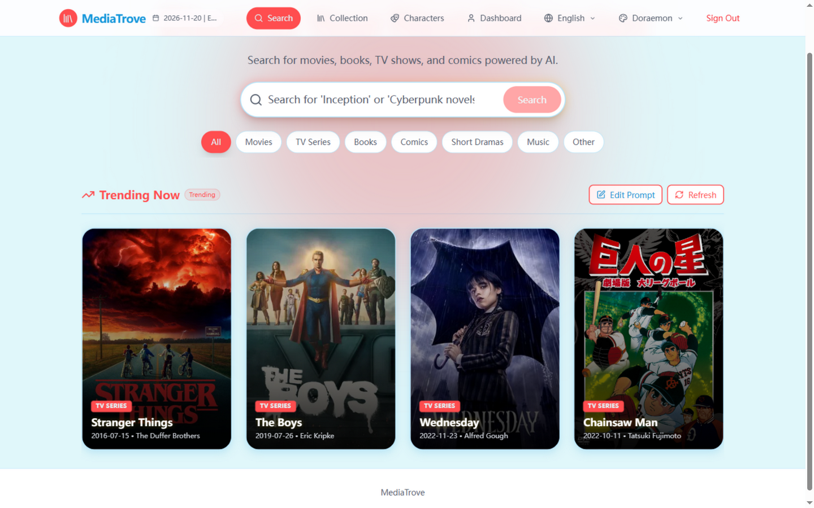
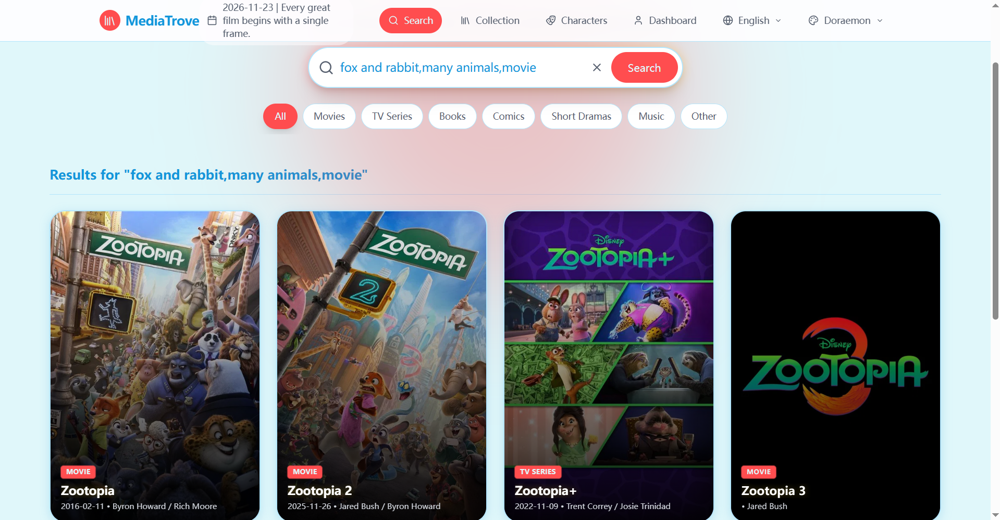
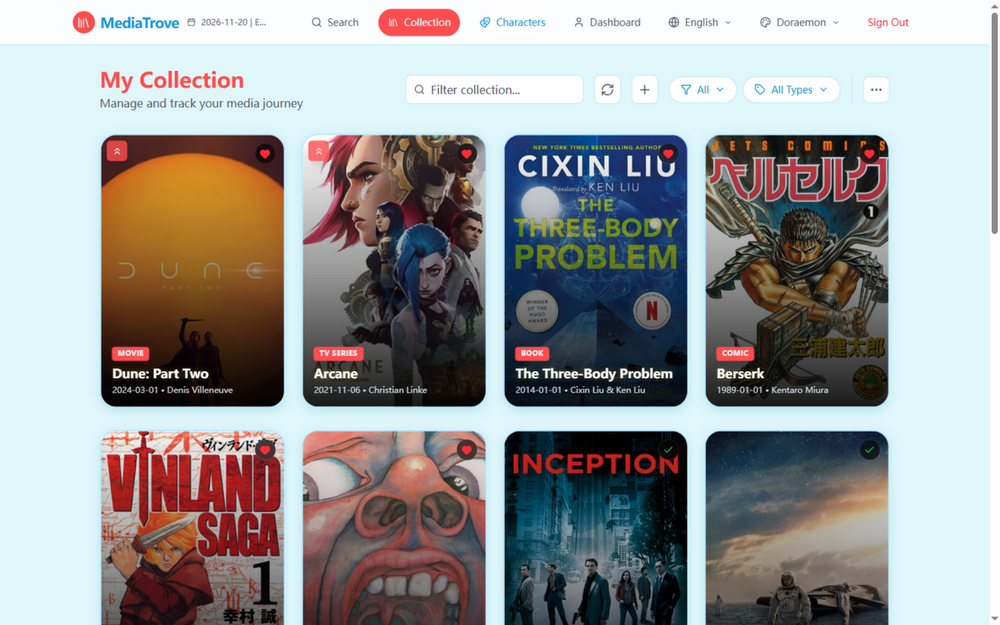
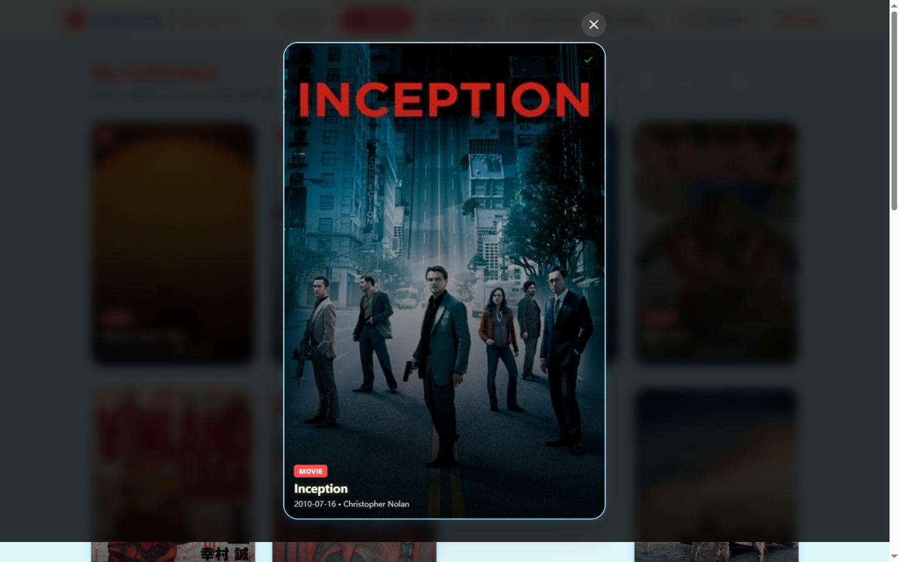
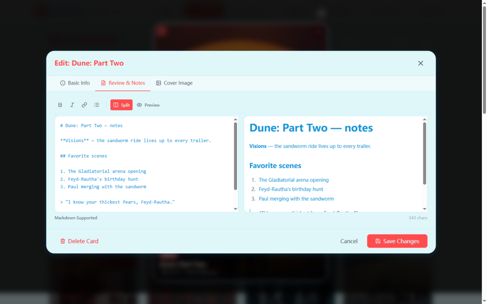
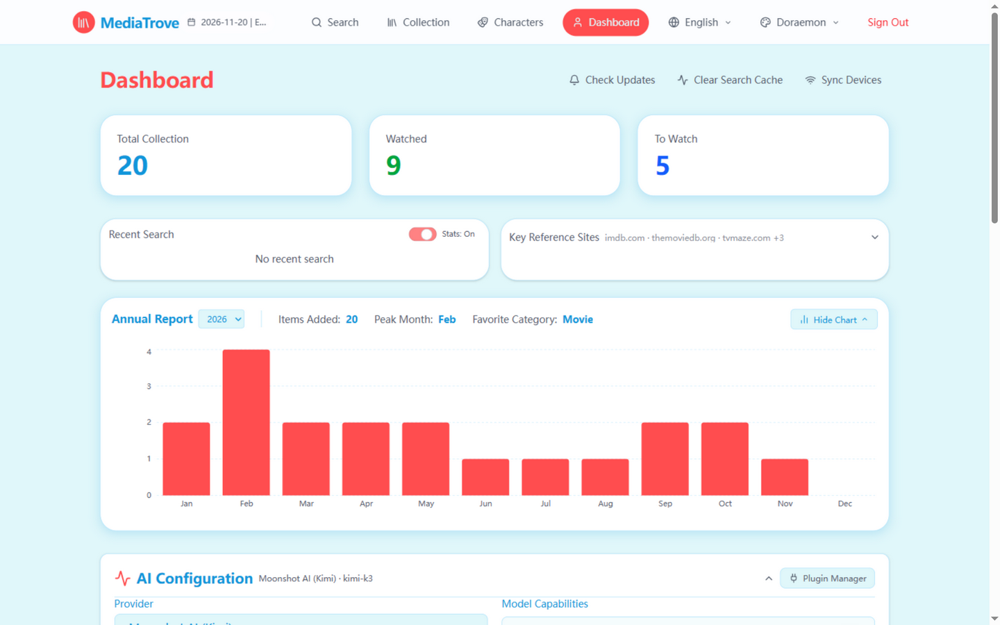
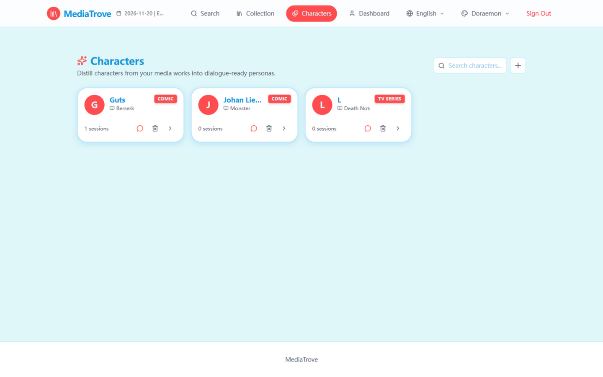
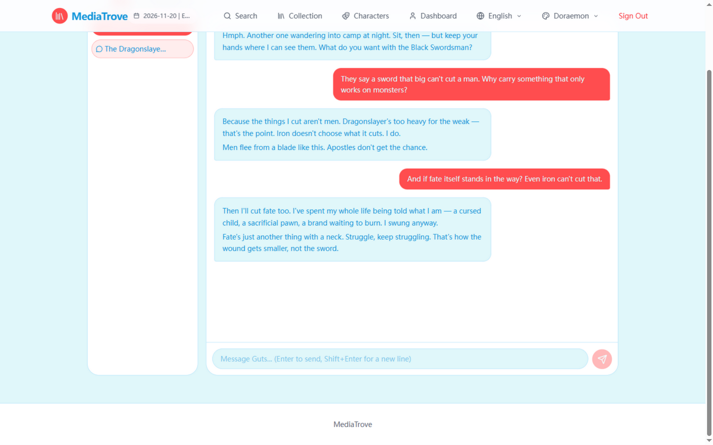

<div align="center">


# MediaTrove

**One home for everything you watch, read, and listen to.**

Search, collect, and track Movies, TV Series, Books, Comics, Short Dramas and Music — on **Windows, macOS, Linux and Android**.


[English](README.md) | [中文](README.zh.md)

[📥 **Download the latest build**](https://github.com/liumeteor11/mediatrove/releases) · [✨ Features](#-features) · [🚀 Quick start](#-quick-start) · [🔒 Privacy](#-privacy--security)

</div>

---

MediaTrove keeps your whole media journey in one local, private collection — and uses AI to make filling it almost effortless. Describe what you're looking for in plain language, get posters and metadata automatically, and follow your ongoing series as new episodes and chapters drop.

Your data stays **on your device**. Nothing is tracked, nothing is uploaded.

## ✨ Features

### 🔍 Search in plain language, powered by AI

Describe what you feel like — *"90s cyberpunk novels"* or *"movies like Interstellar, but newer"* — and MediaTrove aggregates results from TMDB, Bangumi, plugins and AI, ranked so the right match is never buried under fuzzy ones. Trending recommendations come in three flavors (time-based, learned from your collection, or your own custom prompt), and every round automatically avoids repeating what you've already been shown. Everything follows your interface language end to end.

<p align="center">
  
</p>

<p align="center">
  
</p>

### 🔎 Fuzzy search that reads between the lines

Type an abbreviation, an actor's name, or a half-remembered plot — *"AOS"*, *"emily dickinson"*, *"10 years ago, about aliens, had a director and a Chinese actress named Daisy"* — and MediaTrove still finds the work. When plain title lookups come up empty, an AI first-pass rewrites your query into real title candidates that are verified against TMDB, and TMDB person results are mined for their notable works. Once you collect the right work, the app remembers what your shorthand meant and resolves the same query instantly next time — no re-deriving, no waiting. Inside your collection, search matches cast and director too, not just titles.

### 📚 One collection for six kinds of media

Movies, TV series, books, comics, short dramas and music albums live side by side, organized into **To Watch**, **Watched** and **Favorites** — with pinning, drag-and-drop ordering, custom collection folders, and one-click metadata refresh. Ongoing series track themselves: new episodes and chapters are checked automatically (TV series use authoritative TMDB episode data), and the update lands at the top of your grid with a badge.

<p align="center">
  
</p>

### 🧾 Rich details, and notes that render as you write

Every card opens into a full detail view with poster, cast, ratings and progress. Write per-item notes in Markdown with a **live split preview** — the rendered note updates on every keystroke, like Obsidian's live preview. Fully editable metadata means manually-added items and self-curated entries look just as good as the fetched ones.

<p align="center">
  
  &nbsp;
  
</p>

### 📊 Insights & yearly reports

See your year at a glance — items added per month, your peak month, favorite categories — plus search diagnostics (token usage, latency, per-provider performance) when you want to fine-tune the AI plumbing.

<p align="center">
  
</p>

### 🎭 Distill characters, then talk to them

Turn any character from your collection into a structured persona — personality, mental models, decision heuristics, boundaries, timeline, "expression DNA" — grounded by AI web research. Then chat with them in character: streaming replies, per-character session history, and a correction layer (*scene → what not to do → what to do instead*) that takes effect from the very next reply. Re-distilling a work merges new details into the existing persona and keeps your corrections.

<p align="center">
  
  &nbsp;
  
</p>

### 🤖 Bring your own AI

Works out of the box with Moonshot/Kimi, OpenAI, DeepSeek, Qwen, Google, Mistral, MiMo, Zhipu (GLM) — or any OpenAI-compatible endpoint. Model quirks (fixed temperature, rejected tool calls, reasoning-budget hogs) are detected and adapted automatically, so unreleased models work too. Optional search keys (Vertex AI Search, Serper, Yandex, DeepSeek Search) sharpen freshness and accuracy; a keyless built-in DuckDuckGo engine is always available as a fallback.

### 📱 Sync between your devices, and let AI agents help

- **LAN sync** — discover nearby devices automatically over mDNS and sync your collection within your own network.
- **Built-in MCP server** — MCP-capable AI clients can browse and manage your collection with your permission (`list_items`, `add_item`, `update_item`, `remove_item`, `get_stats`, …).

### 🌍 Thoughtful touches

English & 简体中文 with auto-detection · three themes · offline-friendly caching · custom posters or auto-fetched ones · import/export your collection as JSON.

## 📥 Download

Grab the latest installer for your platform from [**Releases**](https://github.com/liumeteor11/mediatrove/releases): Windows (NSIS/MSI), macOS, Linux (AppImage/deb), and Android (APK). Releases are built and published automatically for every `v*` tag.

## 🚀 Quick start

MediaTrove is a local app — no account, no server. Install it, open **Dashboard → AI Configuration**, paste an API key from your favorite AI provider (stored **AES-encrypted** on your device), and start searching. Everything else — TMDB, Bangumi, DuckDuckGo — works without any keys.

<details>
<summary><strong>Building from source (developers)</strong></summary>

Prerequisites: Node.js 18+, Rust (latest stable); for Android builds see the [Tauri prerequisites](https://v2.tauri.app/start/prerequisites/).

```bash
npm install                 # install dependencies
npm run tauri dev           # run the desktop app in development
npm run dev                 # run the web-only preview in a browser
npm run tauri android dev   # run on Android (first: npm run tauri android init)
cd src-tauri && cargo test  # Rust unit tests
npm run tauri build         # build installers for your OS
```

Releases are produced by GitHub Actions: push a `v*` tag (e.g. `v0.1.45`) or trigger the workflow manually to build all platform artifacts as a draft release. Android APK signing reads `ANDROID_KEYSTORE_BASE64`, `ANDROID_KEY_ALIAS`, `ANDROID_STORE_PASSWORD` and `ANDROID_KEY_PASSWORD` from repository secrets, falling back to an unsigned APK.

</details>

## 🔒 Privacy & Security

- **Local first** — your collection lives on your device, full stop.
- **Encrypted keys** — API keys are AES-encrypted before storage.
- **No tracking** — no analytics, no search-history collection, no uploads. LAN sync stays inside your network.

## 📄 License

Licensed under the [GNU Affero General Public License v3.0 only](LICENSE) (AGPL-3.0-only): free to use, study, share and modify — including commercially — as long as derivative works and network services built on it are released under the same license.

**Need to ship it closed-source or offer it as a paid service?** A separate [commercial license](COMMERCIAL.md) is available: open an issue on the repository to request one.

Third-party dependencies keep their own licenses (mostly MIT / Apache-2.0).

---

<sup>Screenshots show demo data in the web preview build. MediaTrove is not affiliated with TMDB or Bangumi; metadata is provided by their public APIs.</sup>
