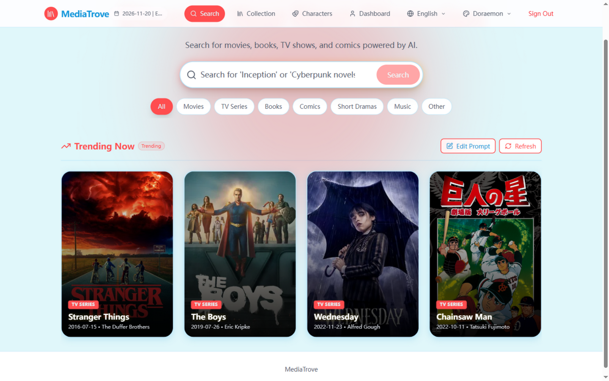
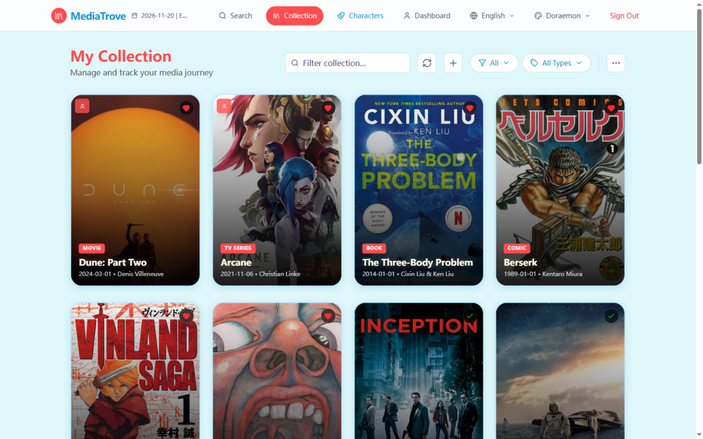
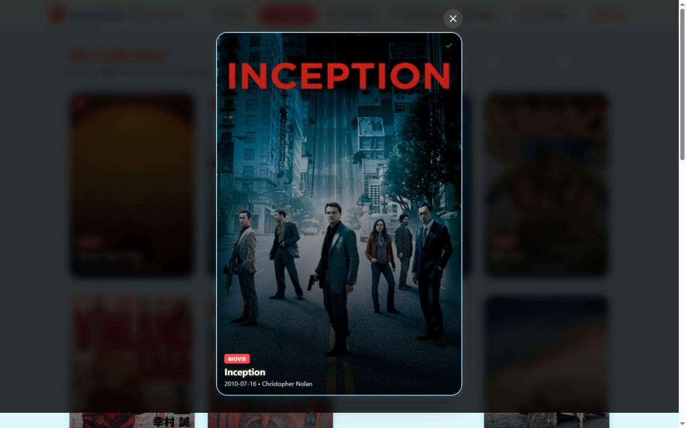
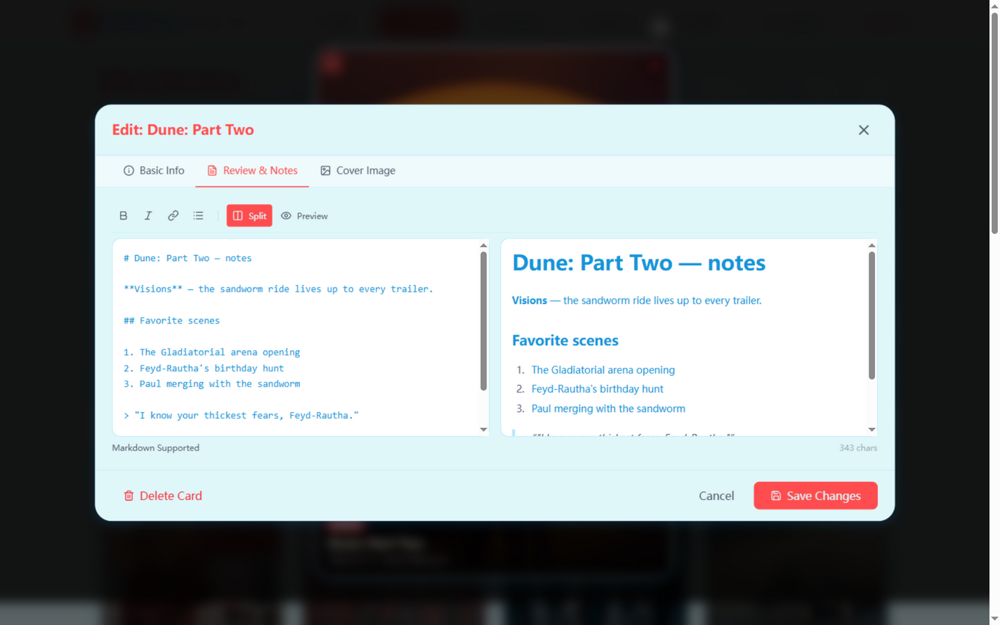
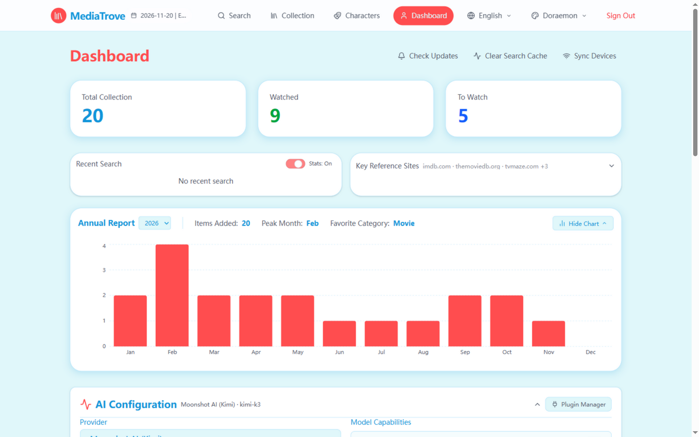
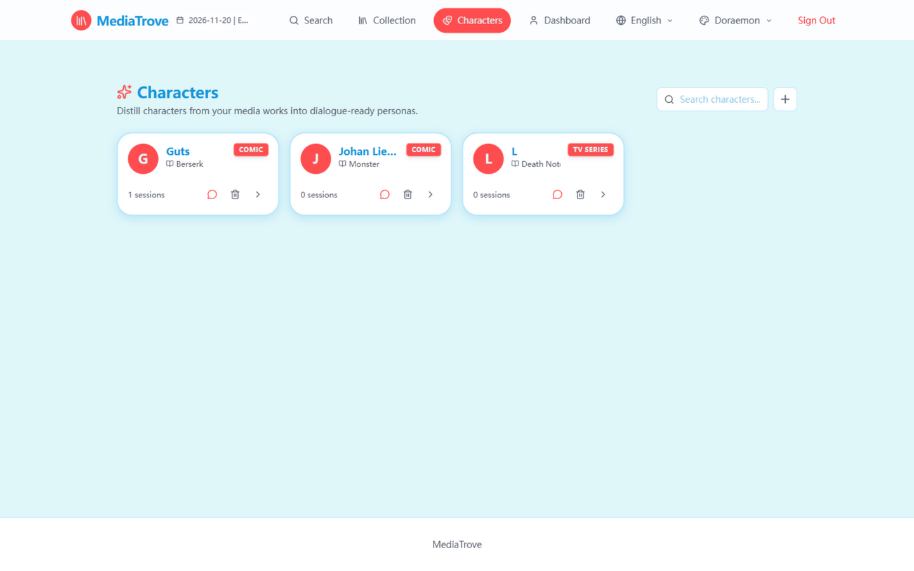
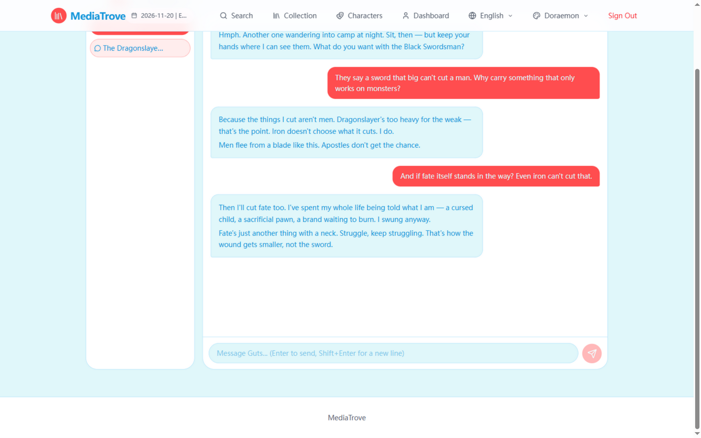
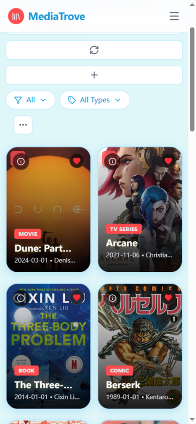

<div align="center">


# MediaTrove

**你看过、读过、听过的每一样东西，都有一个共同的家。**

在 **Windows、macOS、Linux 和 Android** 上搜索、收藏、追踪电影、电视剧、书籍、漫画、短剧和音乐。


[English](README.md) | [中文](README.zh.md)

[📥 **下载最新版本**](https://github.com/liumeteor11/mediatrove/releases) · [✨ 功能](#-主要功能) · [🚀 快速上手](#-快速上手) · [🔒 隐私](#-隐私与安全)

</div>

---

MediaTrove 把你的整个媒体旅程收进一个本地、私密的收藏库，并用 AI 让"填满它"变得毫不费力：用一句自然语言描述你想找的东西，海报和元数据自动补全；连载中的剧集和漫画自动追更。

数据始终留在**你自己的设备上**——不追踪、不上传。

## ✨ 主要功能

### 🔍 用自然语言搜索，AI 驱动

直接描述你的口味——"90 年代的赛博朋克小说"、"和《星际穿越》类似但更新的电影"——MediaTrove 聚合 TMDB、Bangumi、插件与 AI 多源结果，按相关性排序，模糊匹配不会淹没精确结果。热门推荐有三种模式（时间热门、从你的收藏学习口味、自定义提示词），每轮自动排除最近展示过的内容。搜索、推荐与元数据补全全程跟随界面语言。

<p align="center">
  
</p>

### 📚 六类媒体，一个收藏库

电影、电视剧、书籍、漫画、短剧、音乐专辑并列呈现，归入**待看 / 看过 / 最爱**，支持置顶、拖拽排序、收藏夹分组和一键刷新元数据。连载作品自动追更：电视剧使用 TMDB 权威剧集数据，漫画/AI 类自动检查最新章节，更新后带着角标浮到收藏顶部。

<p align="center">
  
</p>

### 🧾 详情丰富，笔记边写边渲染

每张卡片点开就是完整详情：海报、演职人员、评分、进度。支持 **Markdown 分栏实时预览**写笔记——右侧渲染结果随输入逐键更新，类似 Obsidian 的实时预览。元数据完全可编辑，手动添加的条目也能和抓取的一样精美。

<p align="center">
  
  &nbsp;
  
</p>

### 📊 数据洞察与年度报告

一眼看清这一年：每月新增、最活跃月份、最爱类别；还有搜索诊断（Token 消耗、延迟、各搜索源表现），想调优 AI 配置时随时可查。

<p align="center">
  
</p>

### 🎭 蒸馏角色，然后和他们对话

把收藏作品里的任意角色蒸馏成结构化画像——性格特质、心智模型、决策模式、边界雷区、生平轨迹、"表达 DNA"——落笔前由 AI 联网检索作品资料。之后即可进行沉浸式角色扮演对话：流式回复、每个角色独立的会话历史，还有"纠偏层"（场景 → 不应该 → 应该），下一条回复立即生效。对同一作品重复蒸馏会增量合并画像并保留你的纠偏。

<p align="center">
  
  &nbsp;
  
</p>

### 🤖 自带 AI，随时可换

开箱支持 Moonshot/Kimi、OpenAI、DeepSeek、Qwen、Google、Mistral、MiMo、智谱 GLM，以及任意 OpenAI 兼容端点。模型差异（固定温度、拒绝工具调用、思考挤占输出额度）自动探测并适配，新发布的模型也能直接用。可选配置 Vertex AI Search、Serper、Yandex、DeepSeek Search 提升时效与准确性；内置免 Key 的 DuckDuckGo 永远兜底。

### 📱 设备间同步，还能让 AI 智能体帮你管理

- **局域网同步** —— 通过 mDNS 自动发现附近设备，在你的网络内同步收藏。
- **内置 MCP 服务器** —— 支持 MCP 的 AI 客户端经你授权后可直接浏览与管理收藏（`list_items`、`add_item`、`update_item`、`remove_item`、`get_stats` 等）。

### 🌍 贴心细节

英文 / 简体中文自动适配 · 三套主题 · 离线缓存 · 自定义海报或自动抓取 · 收藏可导入导出 JSON。

## 📥 下载

前往 [**Releases**](https://github.com/liumeteor11/mediatrove/releases) 获取最新安装包：Windows（NSIS/MSI）、macOS、Linux（AppImage/deb）与 Android（APK）。每次推送 `v*` 标签都会自动构建发布。

<p align="center">
  
</p>

## 🚀 快速上手

MediaTrove 是本地应用——无需注册、没有服务器。安装后打开**仪表盘 → AI 配置**，粘贴一个你常用 AI 服务商的 API Key（以 **AES 加密**存储在本机），即可开始搜索。其余一切——TMDB、Bangumi、DuckDuckGo——无需任何 Key。

<details>
<summary><strong>从源码构建（开发者）</strong></summary>

前置要求：Node.js 18+、Rust（最新稳定版）；Android 构建见 [Tauri 前置要求](https://v2.tauri.app/start/prerequisites/)。

```bash
npm install                 # 安装依赖
npm run tauri dev           # 桌面应用开发模式
npm run dev                 # 仅前端网页预览
npm run tauri android dev   # Android 运行（首次先: npm run tauri android init）
cd src-tauri && cargo test  # Rust 单元测试
npm run tauri build         # 构建当前系统安装包
```

发布由 GitHub Actions 自动完成：推送 `v*` 标签（如 `v0.1.45`）或手动触发工作流，即可构建全平台产物并发布草稿。Android APK 签名自动读取仓库 Secrets（`ANDROID_KEYSTORE_BASE64`、`ANDROID_KEY_ALIAS`、`ANDROID_STORE_PASSWORD`、`ANDROID_KEY_PASSWORD`），未配置时回退为未签名 APK。

</details>

## 🔒 隐私与安全

- **本地优先** —— 收藏数据只存在你的设备上。
- **密钥加密** —— API Key 存储前均经 AES 加密。
- **无追踪** —— 无统计埋点、不收集搜索历史、不上传数据；局域网同步不出你的网络。

## 📄 许可

本项目采用 [GNU Affero 通用公共许可证第 3 版（仅此版本）](LICENSE)（AGPL-3.0-only）：可自由使用、学习、分享与修改——**包括商业用途**——但衍生作品以及基于它的网络服务必须同样以 AGPL 开源。

**需要闭源分发或作为付费服务提供？** 可申请单独的[商业授权](COMMERCIAL.md)：在仓库提 issue 即可。

第三方依赖仍遵循各自的许可（以 MIT / Apache-2.0 为主）。

---

<sup>截图为 Web 预览构建中的演示数据。MediaTrove 与 TMDB、Bangumi 无隶属关系，元数据来自其公开 API。</sup>
